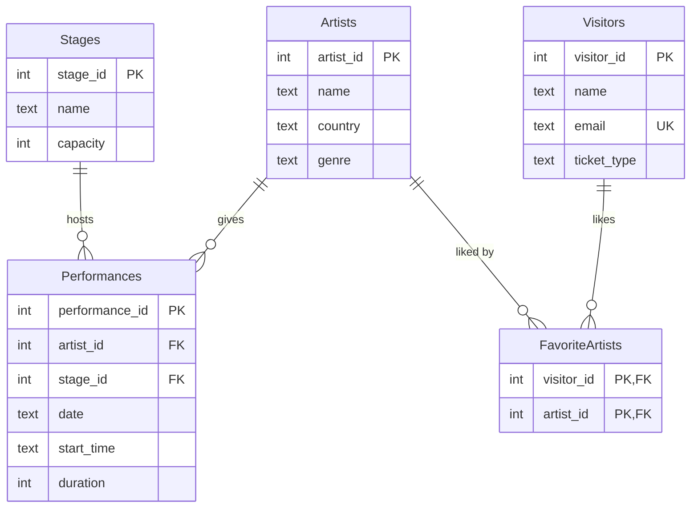

# 🎪 Music Festival Scheduler

A Python + SQLite app for planning a music festival. It stores artists, stages,
performances, visitors and their favourite artists, and its scheduler **refuses
double bookings**: a stage cannot host two shows at the same time, and an artist
cannot be on two stages at once.

## Database design



`FavoriteArtists` is a **junction table** for the many-to-many relationship
(one visitor likes many artists, one artist has many fans). Its primary key is the
pair `(visitor_id, artist_id)`, so the same favourite cannot be stored twice.

## How the clash detection works

Every time is converted to minutes after midnight (`"18:30"` → `1110`).
Two shows overlap when **each one starts before the other one ends**:

```python
s1 < s2 + dur2 and s2 < s1 + dur1
```

| Show A | Show B | Overlap? |
|---|---|---|
| 18:00–19:00 | 18:30–19:30 | ✅ yes |
| 18:00–19:00 | 18:15–18:30 | ✅ yes (B is inside A) |
| 18:00–19:00 | 19:00–20:00 | ❌ no, back to back is fine |

Before a performance is saved, the database is asked only for shows on the **same
day** that use the **same stage or the same artist**, and each one is checked with
this rule.

## Validation

Every add function returns `(success, message)` and never crashes. It rejects:

- unknown artist or stage IDs
- a wrong date or time format (`10-07-2026`, `25:00`)
- zero or negative durations and shows that run past midnight
- stage and artist clashes
- empty names, invalid emails, duplicate emails, unknown ticket types

Changes are only committed after a successful add. The whole schedule can be
re-checked at any time with **Verify schedule**, which compares every pair of performances.

## Test data

On the first run the database is filled with 5 stages, 25 artists, 100 visitors,
their favourite artists, and 40 random performances. Random performances go through
the same validation, so clashing ones are rejected:

```
40 performances scheduled (22 random clashes rejected).
music_festival.db created and filled with test data.

Choice: 5
Schedule is valid: 40 performances, no overlaps.

Choice: 4
...
Not scheduled: stage 1 is already busy at 14:00 on 2026-07-10.
```

Running the program again does not generate duplicate data.

## How to run

```bash
python festival.py
```

Run the tests (16 tests, each with a fresh in-memory database):

```bash
pip install pytest
pytest -v
```

`queries.sql` contains example queries: an artist's schedule, festival days with rock
music, and the most popular artists by number of fans.

## Project structure

```
music-festival-scheduler/
├── festival.py
├── queries.sql
└── tests/
    └── test_scheduling.py
```

## What I learned

- How to model a many-to-many relationship with a junction table and a composite primary key.
- Overlap checks are easy to get wrong; writing down the boundary cases (back to back, one inside the other) first helped.
- `PRAGMA foreign_keys = ON` is required, otherwise SQLite silently ignores foreign keys.
- Parameterized queries (`?`) keep user input out of the SQL text and protect against SQL injection.

## Tech

Python 3 · SQLite (`sqlite3` from the standard library) · SQL · pytest
